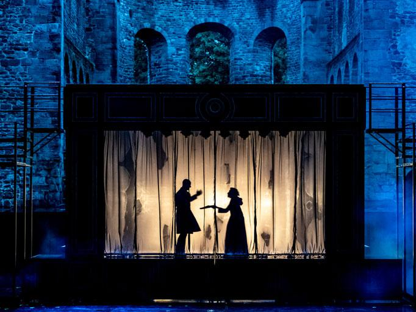
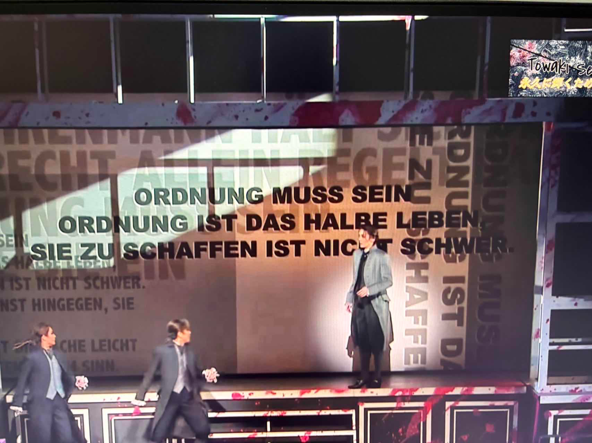
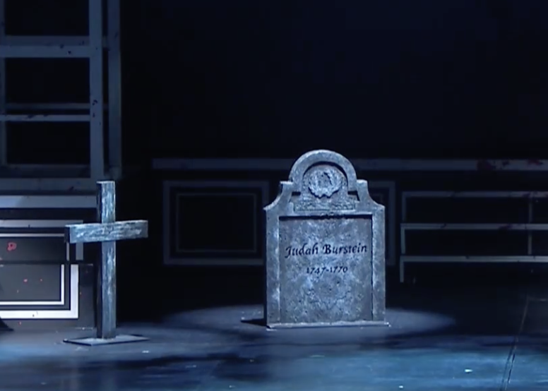
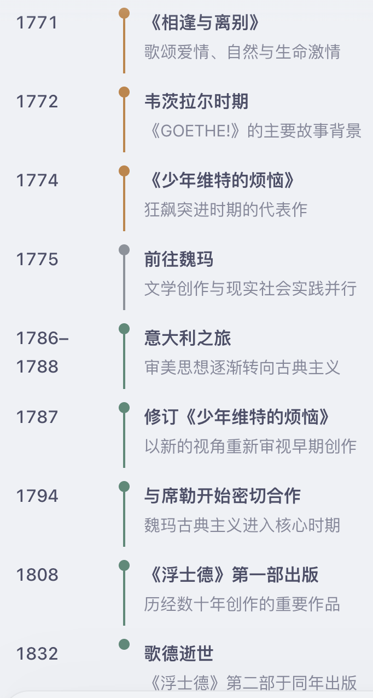

> 本文是参加播客《Musical!Bravo!》第三期节目时准备的大纲稿，保留了录制前的笔记形式，没头没尾，仅供参考。

<!--more-->

## 剧目背景

剧本+导演 Gil Mehmert  《变身怪医》，24/26的一粒沙 con，《爱因斯坦》

基于2010年同名电影（国内译《少年歌德之烦恼》）创作，中途经历了 SE 的股权结构调整，音乐剧项目的关闭，歌德一度胎死腹中

但在 Gil导演的努力下，成为了富克旺根艺术大学的年度音乐剧，当时使用的剧名《Goethe- Auf Liebe und tod》，即17版歌德

之后的再次演出是在2021年的巴德赫尔斯菲尔德戏剧节，以21人乐队的编制上演，目前国内外通行的剧照，花絮包括音乐，都是出自这个版本

2022年宝塚的植田景子休假期间去巴德赫尔斯菲尔德戏剧节看了这部剧，决心将其引进到宝塚，使之成为第一部在宝塚上演的德国音乐剧。作曲 Martin Lingnau 对曲目重新做了一些修订，日语译配则由植田景子和作词 Frank Ramond 共同完成，最后在2025.11.16在东京国际论坛以宝塚花组的部分阵容完成了日本版的初演。目前能看到的完整版的歌德官摄就是由永久辉圣亚和星空美咲（笑）主演的日本版

我的话是在2025.12.6在大阪梅田艺术剧场看的2场，蓝光版本刚好是12.7摄录的。所以现场的演绎路线基本和蓝光版没有什么差别，但 msk 这个时候嗓子还没有哑，实际听感会比蓝光版好很多。

## 拉片

这部剧无论是在德国音乐剧还是宝塚音乐剧范畴都是蛮特别的，全程均为唱段没有台词，那么接下来就稍微简单粗暴一点，基于有完整官摄的日本宝塚版，以每一首歌曲为切分做一个拉片。

剧透预警！

歌词名翻译参考 Up主wannsinnanspruch 的伪官摄翻译

### opening+Goethe？

日版的舞台其实和德版的差别不大，都是使用了类似后面会出现的纸剧场的布局，正前方的阶梯（？）可以前后滑移，形成一个景深效果，在往前滑动的时候又能变成剧场的样式。舞台上方的空间也做了利用，多个场景都可以看到很典型的三角形布局。所以看似舞台装置比较简洁，其实整个舞台空间的利用效率很高，不会觉得很空荡。另外比起德版最大的不同就是在装置的黑色底色上面喷溅了很多的粉色油漆，乍一看就蛮像凶杀案现场的。我自己的过度解读是理解为用枪自杀后溅出的血液，一些在废墟上的故事和新生。

另外就是配角的服装部分。相比于德版只有单调的黑白灰，日版就相当宝塚，显得很花里胡哨色彩丰富。德版的衣着其实蛮现代的，比如这个场景，可以看到很经典的毛衣背心衬衫配牛仔裤这种学院风穿搭，日版这边则更贴合时代背景使用了18世纪带点洛可可风格的西装三件套。其实也可以看作是两版自带的风味，德版更加西区，更学院派，比较偏向大家刻板印象里现代性先锋性的音乐剧，宝塚就更强调“华”一些，正好洛可可风格也是宝塚服装部的舒适区。

这个部分也是纸板马车的第一次出场。如果是平时常看宝塚的朋友估计是第一次见到那么简陋的舞台道具，虽然我们老非中音乐剧人已经习惯看到PPT布景和泡沫板道具了。这个部分宝塚保留了和德版一致的道具风格，其实也是有一定的时代背景在里面。《少年维特之烦恼》的出版年代正好是德国剪影艺术的高峰时期，歌德本人也是剪影艺术的爱好者，他去世时留下了一千多件剪影艺术作品收藏。德版的开场甚至直接以剪影的形式展现，相比之下，日版在剪影或者叫纸片子的使用上已经堪称克制了。

### 梦想如水

这里的梦想如水和第二幕的爱如水使用的同一旋律，而且也形成了很巧妙的互文，都是父亲出于对孩子的关爱对孩子做出的劝导。像类似的旋律复用和互文在本剧里非常多见，走出剧场就开始哼剧中曲子的旋律未必没有这种重复的功劳哈哈哈。

另外这段歌词也化用了歌德1779年所作的《水上精灵之歌》（Gesang der Geister über den Wassern）中的意象，诗歌中用水的循环变化比喻人的灵魂，这里的歌词则指向梦想。

### 何时我能最终成为

就我个人而言，这首歌其实可以称得上本剧中的歌德的主题曲。比起一尘不变的生活，更想要踏上无人知晓的旅途；就算失去一切与全世界为敌，也更想热烈地活着。

歌中展现的歌德相当地赤忱（chen）与天真。他愿意用尽全力毫无保留地去爱一个人，相对地被背叛和伤害时所受到的痛苦也就越大。这种飞蛾扑火式的人生态度就很有戏剧色彩。

### 秩序定如是

这一段的剧情比较贴近历史上的歌德，歌德本人在1772年5月到韦茨拉尔的帝国最高法院实习，也是在这里结识了本剧中的另外三位重要人物，即msk饰演的夏洛特·布夫，hnk饰演的卡尔·威廉·耶路撒冷，以及daiya饰演的阿尔伯特·凯斯特纳的原型，约翰·克里斯蒂安·凯斯特纳。

日版这个部分的塑造蛮有意思的。成绩不佳的歌德最开始拿不到法院的offer，但后来在大庭广众之下走了院长的后门获得了实习资格，成了空降法二代实习生，被其他竞争上岗的同僚孤立搞职场霸凌还怪有说服力的（当然没有说这个行为是对的）。在这种环境下结识了同样被职场霸凌的威廉，称呼他们的组合是“垃圾同士”，很有趣味的同时也能感受到他们之间的战友情也一定将是相当深刻的。虽然是18世纪的职场，但其实也很有现实性，在职场工作过的朋友们多少都能感同身受。

另外日版因为人多方便调度的原因，也设计了非常有意思的小桥段。使用书箱放下的声音去踩节奏重音，丰富音效的同时也给了主角压迫感，相当亮眼。

以及比起德语版更加刻薄尖锐的歌词，日版可以称得上温良了。阿尔伯特回绝歌德的部分就可见一斑。当然也影响到了对阿尔伯特的个性塑造，德版有被观众批评过把阿尔伯特这个人物写得太刻薄和不近人情，日版的改动反而因为某种程度上的实事求是削减了这个人物的不良观感。

这个部分幕布上的三句德语分别是这首歌的德语版歌名及开头的两句台词。翻译过来大概意思是，秩序必然存在。秩序是生命的一半，想要做到它并不难。开头部分只有阿尔伯特站在高台也就是这三句德语的前面，可以看成是具象化的阿尔伯特人生理念的注解了。

### 天使在唱歌到逃离这个世界

这个部分msk人未见而歌先至，msk优秀的唱功完全可以匹配得上《天使在唱歌》的歌名，但蓝光收录版msk嗓子有点哑了，没有正常发挥稍微有点可惜，这段的绝美歌声真的完全可以感受到神性。这段的灯光设计也是很精彩，从前景集中在歌德和威廉的打光渐暗转蓝色射灯将视觉重心移动到刚刚出场的绿蒂，再整场照明渐亮展现出宴会的布景，完成了一段非常丝滑的转场。

宴会上两对情侣也完成了初次见面，从这里其实就能看出两对作为本剧对照组的影子了。四人的重唱也是很经典的外部音乐剧编曲手法，但在宝塚很少见，可以着重关注一下～

这个部分结尾daiya对阿尔伯特的塑造也是我觉得很亮眼的一段。阿尔伯特在看到歌德和威廉一晚没睡的工作成果后，唱“太吃惊了，竟然能做到这个地步”，以及后面用掌声叫醒二位的时候，都是带着笑意的。站在阿尔伯特的立场上看，成绩平平的空降法二代其实不是废物，而是也能加班认真做出成果的勤奋年轻人，完全可以感动到说一句“孩子长大了”（不是）。从上一场处处嫌弃，到后面主动邀请歌德打猎，写求婚台词时第一个想到歌德，这种态度转变的说服力正是基于这个场景这个daiya的微表情。可以说这里是我开始关注和喜欢daiya的契机吧。

再说一下服装部分，到这个场面为止两位主角都换上了本剧中最为重要的代表服装。歌德这边穿上了一度引领当时风潮的维特装，即蓝色外套配黄色马甲及骑马靴；绿蒂则是鱼骨胸衣配蓬蓬裙这种洛可可廓形但露肤度相对高的很不洛可可的搭配。材质方面也选用了少见的相对硬挺的牛仔布和薄透的蕾丝，符合角色个性的同时也非常有记忆点，整体给人的感觉就是又传统又现代，是宝塚服装部相当出彩的设计！

### 生命万岁

作曲家 Martin Lingnau 在2025年的访谈中表示，这首歌所在的骑马场景，是剧中第一次使歌德的色彩理论与狂飙突进精神变得可感的段落。

«少年维特之烦恼»作为狂飙突进运动的代表作之一，很鲜明地体现了该运动的思想内核。具体的部分会放在后面在讲，这边稍微提一下和歌词有联系的内容。

其一是对自然的崇尚和赞颂。草木茂盛鸟儿啼鸣，这些都是大自然蓬勃的生命力，在当时以理性为主导的社会中，

这样的生命力和自由气息就像喘息的气口，显得相当迷人。同时大自然也可以被视作个人情感的延伸和表达，近似于中国古诗词中的借景抒情。另一是对社会束缚的反抗，强调自由，主体性和自我实现的权利。

其实这段我比较推荐大家去听一下德语版的Es lebe das Leben，整个歌词比起日版来说更富有哲学性，而且是我难得觉得德语好听的时候（笑）

另外日版这边去掉了假鸟和假树，改用现代舞的形式来展现。本剧的编舞是德国芭蕾舞团出身的大石裕香和森优贵，所以编舞部分真是非常有当代芭蕾的风格，要不是这部剧咱在宝塚哪能吃到这种细糠啊！

### 来访到无论何时

这一段没有什么好说的甜就完了，过。

### 法律定如是

这部分的庭审内容也和后续的剧情形成了对照，都是和情敌在森林里决斗而被捕。蛮有意思的部分是庭审的时候，阿尔伯特显然对于决斗这个行为深恶痛绝，但第二幕激情上头主动提出要和歌德决斗的也是他。虽然实际上是做局但也能体现出阿尔伯特人物的复杂性。

被告在庭审的陈述使用了歌德1785年创作的诗歌《唯有懂得思念之人》（Nur wer die Sehnsucht kennt）。浓烈的情感表达与冰冷的理性碰撞，也是当时狂飙突进运动面对过于僵化的社会主流价值观时的缩影。

### 信没来！

虽然延续了音乐剧中常见的书信主题，但这首歌却采用了别具一格的编排。歌德与绿蒂并非通过阅读信件倾诉心意，而是在等待来信的过程中，展现出对爱情的期待与不安。两人在奔赴彼此的住所时擦肩而过，大约也是有这段关系有缘而无份的隐喻在。

### 把握当下（Carpe Diem）

这首歌是威廉和玛格丽特两个人物最重要的一首歌，一些情感与现实的撕扯浓缩在了这首歌里。比起德语版本威廉和玛格丽特拥吻后各奔东西，日版则是在预备拥吻前玛格丽特发现了丈夫的身影于是迅速离开。我个人其实更喜欢日版的表达，这种将吻未吻情感张力，玛格丽特张皇逃离和与只能在雨中落寞地看着夫妻二人离去背影的威廉真的特别令人怜爱。

### 笨蛋到相逢和离别-歌德的诗

小情侣玩闹之中，绿蒂对歌德才华的肯定让歌德重新拾起了创作的热情。这部分的歌词使用了与歌名同名的诗歌《相逢与离别》（Willkommen und Abschied）。

另外这部分也诞生了被我和朋友们一致超好评的浪漫台词：“泪水从天空中落下/它为什么哭泣/因为你还没有吻我。”

### 感冒了到永远

过

### 狩鹿到第一幕 ending

狩鹿这个场面是我在第一幕里最喜欢的部分之一！歌好听的同时也有很有压迫感的群舞，观感十分不错！

本剧中最令人心痛的场面也在这部分诞生了。阿尔伯特几乎全程是在歌德的远程（？）指导下完成的整个求婚。绿蒂没有接受求婚的心理准备，闭上眼睛，听到由歌德撰写的求婚台词，会不会恍惚以为眼前人是歌德而不是阿尔伯特，所以再次睁开眼面对现实时，心中的痛苦和落差才更加强烈。答应求婚的过程更是一种阴差阳错，很难不令观众同样感受到命运的捉弄。

这个部分结束后会有一段群像，这里可以着重欣赏一下4位主要人物的小芝居，人物面对未来的，或幸福或纠结挣扎的心理状态，通过类似剪影的小定格展现。作为第一幕结尾和第二幕的开头也留下了悬念，结构上也很工整。

### 第二幕开始到总有一天

第二幕开头从德版绿蒂的solo改成了绿蒂和玛格丽特二人的重唱。这两对小情侣在面对现实时各自有各自的痛苦，但对永恒的爱情的渴望却趋于一致。两位女士在台阶下书写给爱人的离别的信，而台阶上歌德还在傻乐，威廉却已经是抑郁怀有死志了。

### 一封信

过

### 最美好的日子

又是以乐景衬哀情的经典手法。

歌德把纸剧场拿出来时候的鼓点打得真的特别好，而且迅速结束给了留白，这个beat比德版进化了，德版敲到最后也不知道在敲什么……以及最后大家合唱最美好的日子时，可以隐约听到不协和音，刚好给下一个场面做了铺垫。

### 欢迎来到欢乐秀

我戏称为美式霸凌的片段，也是小天空初日新闻竭力隐瞒的场景，因此第一次看的时候给我的震撼非常大。

这一段的整体氛围和第一幕完全脱节，大面积不协和音的运用以及堪比蹦迪的灯光视效很容易将观众拉进嗑high了的迷幻精神世界里。梅菲斯特的出现真的让人眼前一亮，宝塚服装部发力时刻又出现了，这种很亮的皮质和蕾丝面料组合在宝塚真的是少见又少见，非常戏剧costume的思路。夏希真斗的多种音色的运用也非常适役，完全是令人捉摸不定的女巫！

在德国的戏剧评论杂志《Die Deutsche Bühne》和htk的访谈中都有提到这部分和《浮士德》中的瓦尔普吉斯之夜有联系，即魔鬼引诱浮士德进入充满狂欢和欲望的世界，试图让他忘记爱人格蕾琴，但浮士德在过程中看见了神似格蕾琴的幻影从而清醒过来。在本剧中也能看到与上述情节类似的展现。

这一段中也穿插了木偶剧形式的剧中剧，一方面是在上演和背景契合的《浮士德》的剧中剧，另一面也是象征被欲望操控的人也如人偶般变成空壳。和女巫做了交易，签下死亡笔记的威廉最后以自杀收场；短暂沉迷欢乐世界却很快清醒躲在角落试图逃离的歌德最后浴火重生，这组对照的设置也是本剧主题的隐晦表达。

群舞部分音乐做了变速处理，整个氛围显得紧张又迷幻。我的第一场是在梅艺三楼山顶，从上往下看混乱和诡异感完全拉满，之后坐在一楼这样的感觉就淡化掉了。看剧的话果然每个座位和视角都能带来很新鲜的体验。

ps.德奥音乐剧不可缺少的红磨坊part果然在歌德里也是逃不掉的。

### 纸剧场到爱如水

这段继续采用了纸剧场剧中剧的形式展现。旋律和第一幕《梦想如水》一致，都是告诉孩子比起一时的激情，选择安稳的现实才更加可靠的主旨。剧中剧结束以后灯光焦点转向现实，绿蒂的周围是兄弟姐妹们对她承担家庭责任的渴求。母亲早亡又身为长女，对绿蒂来说嫁给阿尔伯特几乎是无可选择的境地。

但某种程度上说对绿蒂而言并非只有绝望和死心。正如父亲的歌词“但若有一份爱/能被安稳地守护/耐心地浇灌/爱终有一日/会开花结果”。王子卸下面具，露出阿尔伯特的脸，其实也能表明阿尔伯特并非仅仅只是觊觎美色，而是希望能和绿蒂以真心换真心。阿尔伯特并非不是良缘，只是绿蒂先遇见了歌德，而三人的华尔兹还是太过拥挤了。

### 把握当下 reprise

威廉的自杀part，虽然主旋律是Carpe Diem的复用，但添加了欢乐秀类似的半音阶，奠定了威廉结局的悲剧色彩。

### 秩序定如是 reprise

也是第一幕《法律定如是》的旋律甚至场景复用。这一幕的阿尔伯特从冷酷对待下属的死亡，将他的殉情视作耻辱，到被歌德激怒变成性情中人喊出“决斗吧”，人物的多面性完全被塑造出来了。我个人更倾向于理解这个部分的阿尔伯特还没有做局的想法，完全是激情上头才决斗的。

### 短暂的人生

这段的旋律是第一幕《生命万岁》的复用，从赞颂自然和生命转向对放弃仅有一次的生命的哀痛，两种极端的情绪碰撞，也是作曲家的巧思之一。

这个部分仔细看的话有两个彩蛋。一个是安葬威廉的工人之一在埋土的时候偷偷从土里捡到了威廉的遗物揣兜里，可能怀表or金子这类值钱的东西吧哈哈哈。

第二个是墓地里的另一块墓碑上写着Judah Burstein（1747-1770），意味着墓碑主人年仅23岁，我个人猜测这位是否就是第一幕受审场面的被害人，但目前找不到可靠的依据证实。

### 决斗

这个部分也是展现出阿尔伯特人物复杂性的片段。阿尔伯特虽然是情敌哥，但对待歌德仍然抱持有一点朋友同僚的情谊。阿尔伯特明知歌德枪法不准于是让他先开枪坐实决斗的事实，但轮到自己射击的时候却拖拖拉拉还在故意寻找身位，也提前通知了大法官前来决斗场地制止这场决斗。我们情敌哥只是想要歌德坐牢不能和绿蒂见面而已，不是真要他命啊！虽然面对大法官的时候阿尔伯特真的很绿茶……

德语版中“三人同行，必有一人多余”（Drei sind gewiss einer zu viel.）在日语版中被译为“三人终究无法共舞/这爱的华尔兹”（三人では無理、愛のワルツ），真是非常巧妙的译配！

### 何时能获得她的爱

写repo的时候我说过这段阿尔伯特是“不被爱的才是小三，小三怎么是正牌老公我自己”。而且这段旋律是第一幕《何时我能最终成为》的复用，属于歌德的主题曲在这里响起，阿尔伯特感觉就像变成绿蒂“白月光的替身”一样……

### 婚纱

我愿称穿婚纱的msk是妈妈！！太美了！！

另外日本人写的repo里提到了一些服装上变化的微妙之处。msk前面的几套服装都是露肚子的，直到婚纱这套才变成真正意义上的连身dress，可能意味着绿蒂从自由开放的单身状态变成阿尔伯特的妻子，裸露的皮肤也不再能被外人看到了。我觉得这个解读很有意思，可以参考！

### 少年维特之烦恼

这个部分也是我本剧最爱的场景之一！在这个片段里，舞台上方的女仆们将缝制好的头纱固定在衣架上，薄纱从舞台上方垂落，也能见到印在薄纱上的文字。而透过薄纱可以看到舞台里侧书中的维特与绿蒂的双人舞。

相比起21/22版并不透明，更类似于书籍的幕布形式，日版采用了更接近17版的薄纱形式，既和上一幕绿蒂的婚纱形成了呼应，也在朦胧中展现了《少年维特之烦恼》这本书中，理想的维特和绿蒂的爱情故事。

《少年维特之烦恼》本质上是歌德和绿蒂两人共同写就的文字，舞台设置了歌德在用羽毛笔写作，二人交会，将稿纸递给绿蒂，绿蒂阅读的形式。两位的重唱配合歌词的诉说，很难不让人共同为这段短暂而深刻的爱情落泪。

歌词中对这对爱人的恋爱路程进行了回顾，然后点出了本剧最重要的内核“理性至上才是至爱”，这段的歌词真的写的提纲挈领又很有优美，完全将词作家的功力展现地淋漓尽致。

### 别离

维特究竟想要的是什么？是在乡村琐碎枯燥的日常中抹去梦想和灵魂，还是去追逐充满荣光的人生?

比起还在纠结于爱不爱的，略显幼稚和固执的歌德，绿蒂已经为他们两人选择了最好的答案。“为了爱而舍弃/我绝不允许”，绿蒂对歌德而言，不仅仅是爱人，还是缪斯和人生导师，没有这份出于理性的退让和深切的爱，很难想象一个人能为另一个人做到如此地步。

### 结婚仪式到生与死的迷宫

这段也过。

### 燃烧的生命

在备受打击而匍匐在地的歌德后面，是从逆光中走来的拿着羽毛笔的花嫁绿蒂。这个部分的打光，现场看起来完全就像神明从明亮的梦中走来，将象征着文学梦想的羽毛笔递到歌德面前。谁能忍住不喊msk一声妈妈！

苦涩虽是人生的底色，但仍要永不言弃，热烈地活下去，这是歌德的宣言。不再沉溺于欲望和痛苦，而是决心追寻文学理想的歌德就像凤凰浴火重生，发射出相当夺目的光彩。

### 歌德finale

虽然故事最终的结局，歌德和绿蒂没能达成世俗意义上的 HE，但仔细想来，也许每个人都找到了属于自己的最合适的人生道路。爱不仅仅是初遇时的激情，还有背后默默的守护和付出。

整个故事的底色其实是很温暖的，没有绝对的反派恶人，更多的是基于自己的立场做出的建议和决定，残酷之下都透着一丝温柔。这样很有层次又相当工整的故事其实在宝塚并不多见，所以就算距离初演已经快一年也仍然是我特别喜欢，愿意 n 刷的好剧。

## 少年维特之烦恼/魏玛古典主义的时代背景

《少年维特的烦恼》与魏玛古典主义（Weimarer Klassik）分别代表了歌德文学生涯中两个不同的阶段：前者是青年歌德狂飙突进时期的代表作，后者则代表歌德思想与艺术逐渐走向成熟的时期。

18世纪70年代，德意志尚未实现国家统一，仍处于神圣罗马帝国时期，由众多大小邦国组成。社会中存在着严格的等级制度，贵族拥有相当大的政治与社会特权，而逐渐壮大的市民阶层开始追求个人尊严、思想自由与自我实现。与此同时，欧洲启蒙运动推动了人们对传统权威的质疑。卢梭对自然、情感与个人自由的推崇，也深刻影响了当时的青年知识分子。

个人意识的觉醒与尚未改变的社会秩序之间，存在着巨大的矛盾。

狂飙突进运动（Sturm und Drang）是18世纪后半叶兴起于德意志地区的文学革新运动，强调：

- 个体情感与自由意志。

- 对自然和生命力量的崇尚。

- 艺术家的独立创造力，即天才崇拜（Geniekult）。

- 对封建等级、僵化礼法与传统艺术规范的反抗。

《少年维特的烦恼》成书于1774年，在1787年进行了修订。不仅描写了一场无法实现的爱情，也表现了一个具有强烈自我意识的青年，如何在个人理想与社会现实的冲突中走向毁灭。

魏玛古典主义（Weimarer Klassik）：广义时期：1786—1832年

1789年爆发的法国大革命，对欧洲知识界造成了极大的冲击。

自由、平等与人的解放成为重要的时代议题，但革命过程中出现的暴力与社会动荡，也促使歌德和席勒重新思考：人类应该通过何种方式获得真正的自由？

他们试图通过文学、艺术与审美教育，促进人格的完善，使人能够在感性与理性、个人欲望与社会责任之间找到平衡。这种对于完整人格的追求，被称为 Humanität（人文精神），也是魏玛古典主义的核心思想之一。

魏玛古典主义并不是对狂飙突进精神的彻底否定，而是试图解决狂飙突进运动所留下的矛盾。

如果说青年歌德追问的是“人如何才能自由地生活”，那么成熟时期的歌德更加关注的是“人如何才能在现实世界中自由而完整地生活”。

从第一幕中歌德对生命和自由的热烈歌颂，到第二幕中面对爱情的失败、友人的死亡，剧中的歌德逐渐意识到，个人的意志和情感并不能解决现实中的一切问题。

但他最终没有走上维特的道路，而是选择了文学创作。

这也是音乐剧与小说之间最重要的区别：

维特在无法调和情感与现实的矛盾中走向死亡，而歌德将这种矛盾转化成了艺术，获得了继续生活的力量。

从文学史的角度来看，这也可以被理解为后来歌德走向魏玛古典主义的一种精神预示。

歌德晚年在与爱克曼的谈话中，曾将自己创作《少年维特的烦恼》的经历比作鹈鹕啄开自己的胸膛，以鲜血哺育幼鸟。失去爱情的青年歌德，最终成为了书写爱情的人；亲历生命悲剧的歌德，最终成为了探索人类精神世界的文学家。这个转变，也构成了他此后数十年文学生涯的起点。
